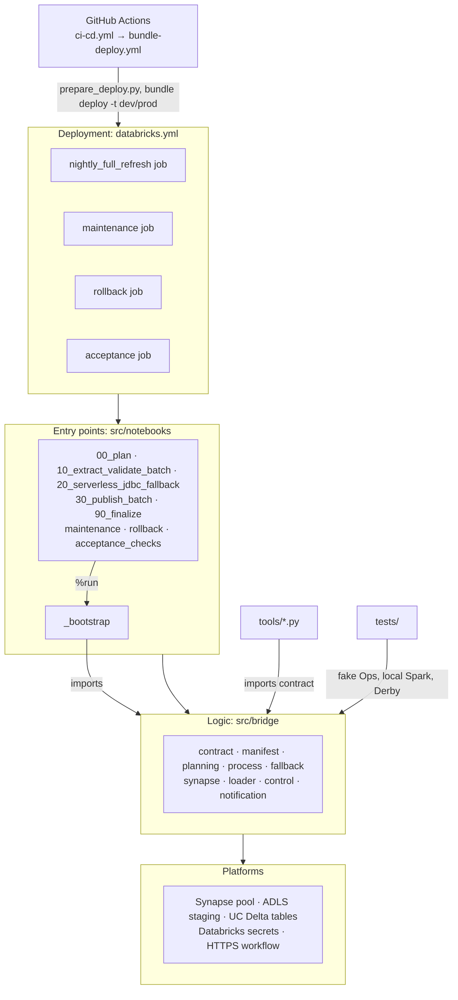
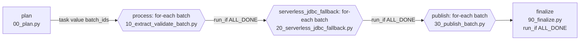
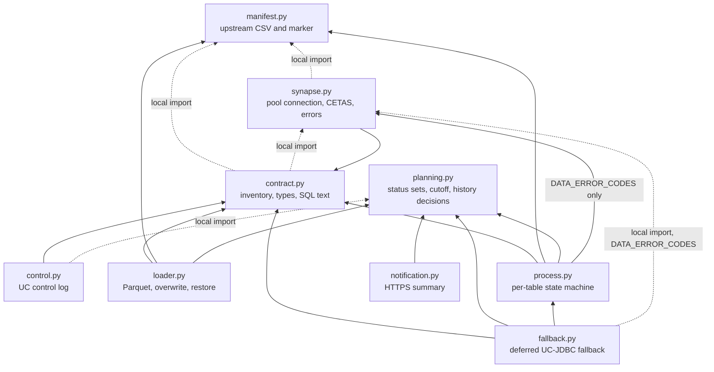
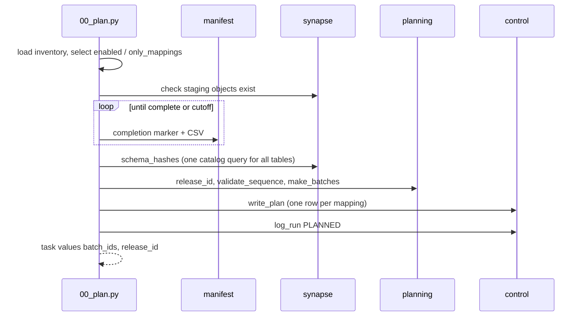
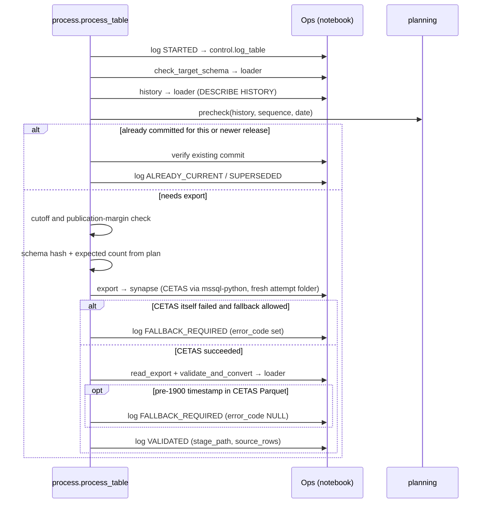
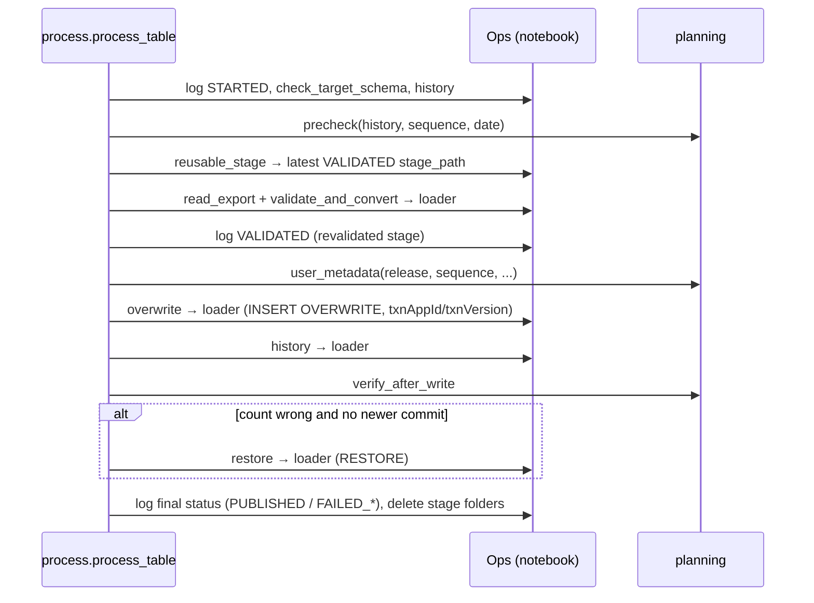

# Code structure (v2.6.9)

This document shows how the code is wired together: which job runs which
notebook, which notebook uses which module, which module imports which, and
the call sequence for one table. For what each file is *for*, see
[PACKAGE_GUIDE.md](PACKAGE_GUIDE.md). For *why* it is designed this way, see
[DESIGN.md](DESIGN.md). For the data that moves between the pieces, see
[DATA_DICTIONARY.md](DATA_DICTIONARY.md).

## 1. Layers

The layering rule: **decisions live in `src/bridge`, platform handles live in
the notebooks.** `process.py`, `fallback.py`, `planning.py`, `contract.py` and `manifest.py`
contain no Spark session, `dbutils` or secret access of their own. The
`10_extract_validate_batch` and `30_publish_batch` notebooks pass real platform
operations into `process.process_batch`, and `20_serverless_jdbc_fallback` into
`fallback.run_batch`, as an `Ops` object. Tests pass a fake `Ops`, which is how
every failure path is tested without Databricks or Synapse.

The nightly job runs every task on serverless compute. Command SQL (plan checks,
counts, CETAS) goes through `mssql-python` (`synapse.connect`); the fallback reads
through the Unity Catalog JDBC connection (`loader.uc_jdbc_export`).

## 2. Jobs and tasks (`databricks.yml`)

| Job | Schedule (Sydney) | Tasks → notebook | Retries |
|---|---|---|---|
| `nightly_full_refresh` | 01:30 daily | `plan` → `00_plan.py`; `process` (for-each, concurrency `export_concurrency`) → `10_extract_validate_batch.py`; `serverless_jdbc_fallback` (for-each, `run_if: ALL_DONE`) → `20_serverless_jdbc_fallback.py`; `publish` (for-each, `run_if: ALL_DONE`) → `30_publish_batch.py`; `finalize` (`run_if: ALL_DONE`) → `90_finalize.py`; all serverless | plan 0, each batch task 1, finalize 0 |
| `maintenance` | 14:00 Sunday | `maintenance` → `maintenance.py` | — |
| `rollback` | Manual | `rollback` → `rollback.py` | — |
| `acceptance` | Manual, before go-live | `acceptance` → `acceptance_checks.py` | — |

`process` itself runs with `run_if: ALL_SUCCESS` (it needs a plan). Each for-each
has the same inputs (`batch_ids`) and concurrency (`export_concurrency`), so batch
*n* of every phase handles the same mappings. Each phase is a barrier: no table
publishes until every extract and fallback batch has finished (DESIGN 3.4).

What passes between tasks:

| From → to | Channel | Content |
|---|---|---|
| `plan` → for-each | Task value `batch_ids` | List of batch numbers `[0 … N]`. |
| `plan` → every batch task | UC table `plan` | Mappings, expected counts, schema hashes and cutoff for that batch. |
| extract → fallback | UC table `table_log` | `FALLBACK_REQUIRED` (or a `FALLBACK_STARTED` left by a crash) for this job run. |
| extract / fallback → publish | UC table `table_log` + ADLS stage | `VALIDATED` event with `stage_path`, `method` and the proven `source_rows`. |
| publish → `finalize` | UC table `table_log` | Latest status per mapping for this job run. |
| `finalize` → operator | HTTPS POST | Run summary JSON. |
| All tasks | Job parameters / widgets | `job_run_id`, `repair_count`, `batch_id`, `business_date`, `only_mappings`, and similar. |

Tasks share no memory. Everything a later task needs is read back from Unity
Catalog, which is why a Repair run or task retry can resume safely.

## 3. Module dependencies (`src/bridge`)

Arrows point from the importing module to the imported one. Dotted arrows are
imports inside a function, used to avoid a circular import at load time.

Rules that keep this graph simple:

* `planning.py` and `manifest.py` import no other bridge module, so the
  decision rules can be tested in isolation.
* `process.py` and `fallback.py` never import `loader.py` or `control.py`. They
  reach Spark, storage and the log only through the injected `Ops` object.
* Only `loader.py` imports `pyspark`. Everything else can be tested without Spark.

## 4. Which notebook and tool uses which module

| Entry point | contract | manifest | planning | synapse | control | loader | process | notification |
|---|---|---|---|---|---|---|---|---|
| `00_plan.py` | ✓ | ✓ | ✓ | ✓ | ✓ | ✓ | | |
| `10_extract_validate_batch.py` | ✓ | | | ✓ | ✓ | ✓ | ✓ | |
| `20_serverless_jdbc_fallback.py` (+ `fallback`) | ✓ | | | ✓ | ✓ | ✓ | ✓ | |
| `30_publish_batch.py` | ✓ | | ✓ | | ✓ | ✓ | ✓ | |
| `90_finalize.py` | ✓ | | ✓ | | ✓ | ✓ | | ✓ |
| `maintenance.py` | ✓ | | | ✓ | | | ✓ | |
| `rollback.py` | ✓ | | ✓ | | ✓ | ✓ | | |
| `acceptance_checks.py` | ✓ | ✓ | ✓ | | | ✓ | | |
| `tools/generate_inventory.py` | ✓ | | | | | | | |
| `tools/render_uc_setup.py` | ✓ | | | | | | | |
| `tools/prepare_deploy.py` | ✓ | | | | | | | |

`_bootstrap.py` imports every module except `manifest` and `fallback` (which
`00_plan`/`acceptance_checks` and `20_serverless_jdbc_fallback` import themselves), sets the Spark session to UTC and
Parquet rebase modes, and loads the deployed `config/inventory.json` from a
fixed path, so a job parameter cannot redirect it.

## 5. Nightly call sequence

### 5.1 Plan

### 5.2 Extract and validate one table

`10_extract_validate_batch.py` reads its plan rows, builds a `process.Context`, and calls
`process.process_batch(ctx, mappings, Ops(), already=..., validate_only=True)`.
The batch loop skips tables already terminal (or already `FALLBACK_REQUIRED`)
for this job run and calls `process.process_table` for the rest, one at a time.
Each `ops.*` call below is a method of `Ops` in the notebook that forwards to the
named module.

After the loop, the notebook raises if any table ended with a transient
status. The task's single retry then reprocesses only those tables.

### 5.3 UC-JDBC fallback for one table

`20_serverless_jdbc_fallback.py` selects the batch's mappings with
`fallback.pending` (latest event `FALLBACK_REQUIRED`/`FALLBACK_STARTED`, or a
transient fallback failure from `control.failed_fallbacks`) and calls
`fallback.run_batch`. Per table, `fallback.run_table`:

1. skips with `SKIPPED_CUTOFF` when the publication deadline leaves no time;
2. logs `FALLBACK_STARTED`;
3. reads through the UC JDBC connection (`loader.uc_jdbc_row` for partition
   bounds, then `loader.uc_jdbc_export`) into the `…-jdbc/` folder, bounded by
   the deadline;
4. reads the stage (requires `_SUCCESS`) and runs `loader.validate_and_convert`;
5. proves the row count: the manifest count if it matches, otherwise one
   `loader.uc_jdbc_count`; rejects 0 rows unless `allow_empty`;
6. logs `VALIDATED`, or a deterministic status, or `FAILED_EXPORT`/
   `FAILED_COUNT_MISMATCH`/`FAILED_UNKNOWN` with `method = JDBC`.

The notebook raises for transient failures, so the task retry re-attempts only those.

### 5.4 Publish one table

`30_publish_batch.py` selects every mapping with a `VALIDATED` event in this job
run that has not reached a terminal status, and calls
`process.process_batch(..., already={id: "VALIDATED"}, validate_only=False)`.
Its `Ops` refuses CETAS, JDBC, schema-hash and Synapse count calls.

### 5.5 Finalize

`90_finalize.py` runs even if batch tasks failed (`ALL_DONE`):

1. `control.read_plan` and `control.latest_outcomes` for this job run.
2. `planning.summarise` (missing outcome = `NOT_STARTED`), `planning.late_publications`, `planning.failure_ratio`, `control.fallback_counts`.
3. `control.log_run` `FINISHED` or `FINISHED_WITH_FAILURES` (releases the write fence).
4. `notification.summary_payload` and `notification.send_summary`, then `control.log_run` `SUMMARY_NOTIFIED`.
5. Raise, failing the job, if a deadline was missed, the fallback or failure-ratio threshold was crossed, a mandatory table failed, or `fail_on_any_failure` is on and anything failed.

## 6. Which tests cover which module

| Module or area | Main test files |
|---|---|
| `contract.py` | `test_contract.py` |
| `manifest.py` | `test_manifest.py` |
| `synapse.py` | `test_synapse_checks.py`, `test_jdbc_derby.py`, `test_serverless_synapse_dbapi.py` (`mssql-python` adapter and errors) |
| `planning.py` | `test_planning.py`, `test_v26_recovery.py` |
| `process.py` | `test_process.py` (fake `Ops`) |
| `fallback.py`, `20_…`/`30_…` notebooks | `test_v266_regressions.py`, `test_v267_regressions.py` (notebooks executed against fakes) |
| `loader.py` | `test_loader_spark.py` (local Spark), `test_jdbc_derby.py` |
| `notification.py` | `test_notification.py` |
| `control.py` | `test_loader_spark.py`, `test_v23_…`, `test_v24_…`, `test_v25_…`, `test_v263_regressions.py` (query and helper checks) |
| `tools/`, `databricks.yml` | `test_tools.py`, `test_compute_variant.py` (serverless placement) |
| GitHub deployment | `test_deploy.py` |
| `AGENTS.md` accuracy | `test_agents_doc.py` |
| Past review findings | `test_v20_…` through `test_v268_regressions.py` |

Behaviour that only a real workspace can show (Delta transaction guard, UC
grants, RESTORE, runtime exceptions) is checked by `acceptance_checks.py` and
the first non-production night. See [RELEASE_VALIDATION.md](RELEASE_VALIDATION.md).
