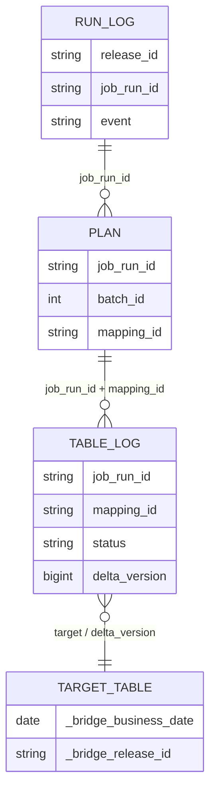

# Data dictionary (v2.6.9)

This document describes every piece of data the package writes or passes
between stages: the Unity Catalog control tables and views, the identifiers
and paths used to connect them, the metadata stamped on target tables, and the
summary sent to the operator workflow.

The column definitions are generated from code. The source of truth is
`CONTROL_TABLES` in `tools/render_uc_setup.py` and the matching `TABLE_LOG`,
`RUN_LOG` and `PLAN` constants in `src/bridge/control.py`. If you add a column,
change both files, prepare a reviewed `ALTER TABLE ADD COLUMN` for every
environment already installed, and update this document.

`<ctl>` below means `control.catalog`.`control.schema` from `inventory.json`.

## 1. How the control data fits together



One nightly (or targeted recovery) job run writes:

1. one `PLANNED` row in `run_log` and one `plan` row per selected mapping (by `00_plan`);
2. several `table_log` rows per mapping, one per state change (by
   `10_extract_validate_batch`, `20_serverless_jdbc_fallback` and `30_publish_batch`);
3. a `FINISHED` or `FINISHED_WITH_FAILURES` row, then a `SUMMARY_NOTIFIED` row, in `run_log` (by `90_finalize`).

All three tables are **append-only** (except `plan`, see below). Current state
is always derived as "the latest event", never updated in place. Blind appends
never conflict in Delta, so concurrent batch tasks can log without locks.

## 2. Control tables

### 2.1 `<ctl>.plan`: what this job run will process

Written by `00_plan` through `control.write_plan`. Read by the
extract, fallback and publish tasks (their own batch) and `90_finalize` (all rows). A rerun of the plan task in the
same job run deletes and replaces only that job run's rows.

| Column | Type | Meaning |
|---|---|---|
| `job_run_id` | STRING | Databricks job run ID (`{{job.run_id}}`). Joins plan to logs. |
| `release_id` | STRING | Source release being published, `<source_set_id>-<upstream_sequence>` (section 3). |
| `batch_id` | INT | Zero-based batch number. One for-each iteration processes one batch. |
| `position` | INT | Order of the mapping inside its batch. Tables in a batch run one after another. |
| `mapping_id` | STRING | Inventory mapping ID (one source object → one target table). |
| `mandatory` | BOOLEAN | From the inventory. A failed mandatory mapping fails the job at finalize. |
| `business_date` | DATE | Sydney business date certified by the upstream completion signal. |
| `upstream_sequence` | BIGINT | Upstream revision, `YYYYMMDD00`–`YYYYMMDD99`. Also the Delta `txnVersion`. |
| `cutoff_utc` | TIMESTAMP | Publication deadline in UTC (07:00 Sydney nightly, 11:00 for recovery). |
| `planned_utc` | TIMESTAMP | When the plan row was written. Used for retention. |
| `expected_rows` | BIGINT | Row count from the upstream manifest. NULL if not in the manifest or verification is off. |
| `count_source` | STRING | Where the expected count will come from: `manifest`, `synapse` (count at run time) or `none` (`verify_source_count=false`). |
| `source_schema_hash` | STRING | Hash of the source columns from one catalog query at plan time. NULL if the object was missing. Compared with the inventory hash. |

### 2.2 `<ctl>.table_log`: per-table events

Written by `process.process_table` (through `Ops.log` → `control.log_table`)
and by `rollback.py`. Several rows per mapping per attempt, one per status.

| Column | Type | Meaning |
|---|---|---|
| `release_id` | STRING | Release being published. `manual-rollback` for rows written by `rollback.py`. |
| `job_run_id` | STRING | Job run that wrote the event. `manual` for rollback rows. |
| `mapping_id` | STRING | Inventory mapping ID. |
| `target` | STRING | Fully qualified UC target, `catalog.schema.table`. |
| `mandatory` | BOOLEAN | Copied from the inventory. |
| `attempt_id` | STRING | One export attempt, `YYYYMMDDTHHMMSSZ-<8 hex>` (UTC start time plus random suffix). |
| `status` | STRING | Event status. Full list and meanings: `AGENTS.md` section 6, summarised in section 5 below. |
| `source_rows` | BIGINT | Expected source row count used for validation. |
| `parquet_rows` | BIGINT | Rows found in the staged Parquet. |
| `written_rows` | BIGINT | Rows committed, from the Delta history metric. Set on `PUBLISHED` and `ALREADY_CURRENT`. |
| `delta_version` | BIGINT | Target Delta version committed, verified, or restored to. |
| `stage_path` | STRING | Full ADLS path of the staged Parquet folder (CETAS folder, or its `-jdbc` sibling). |
| `detail` | STRING | Human-readable reason or error, truncated to 4,000 characters. First place to look when a table fails. |
| `event_utc` | TIMESTAMP | When the event was logged. "Latest event" ordering uses this column. |
| `method` | STRING | Export route: `CETAS` or `JDBC`. |
| `error_code` | INT | Synapse SQL error number. On `FALLBACK_REQUIRED`, a non-null value marks a CETAS-error fallback (`0` = SQL Server returned only a SQLSTATE, named in `detail`) and NULL a historical-timestamp reroute. |
| `duration_seconds` | DOUBLE | Seconds from the start of processing this table to this event. |
| `count_source` | STRING | Where `source_rows` came from: `manifest`, `synapse`, `synapse_after_manifest_zero`, `synapse_after_manifest_mismatch`, `prior_verified_publication`, `validated_stage`, `uc_jdbc` (counted through the UC JDBC connection by the fallback), `uc_jdbc_after_manifest_mismatch` or `none`. |
| `commit_utc` | TIMESTAMP | Delta commit time of the publication. Finalize uses this, not `event_utc`, to decide whether a table was late. |

### 2.3 `<ctl>.run_log`: per-job-run events

Written by `00_plan` and `90_finalize` through `control.log_run`.

| Column | Type | Meaning |
|---|---|---|
| `release_id` | STRING | Release being published. |
| `job_run_id` | STRING | Databricks job run ID. |
| `event` | STRING | One of the events in the table below. |
| `business_date` | DATE | Sydney business date. |
| `upstream_run_id` | STRING | Upstream pipeline's run ID from the completion signal. Set on `PLANNED`. |
| `upstream_sequence` | BIGINT | Upstream revision. |
| `inventory_version` | STRING | `inventory_version` of the deployed `inventory.json`. |
| `detail` | STRING | JSON document, truncated to 4,000 characters. Contents depend on the event. |
| `event_utc` | TIMESTAMP | When the event was logged. |

| `event` | Written by | `detail` contains |
|---|---|---|
| `PLANNED` | `00_plan` | Table and batch counts, cutoff, completion source, manifest summary and warnings, missing source objects, Databricks runtime build. |
| `FINISHED` | `90_finalize` | Full run summary (status counts, failures, deadline, fallback and failure-ratio checks). Job result is OK. |
| `FINISHED_WITH_FAILURES` | `90_finalize` | Same summary. At least one failure rule was hit. |
| `SUMMARY_NOTIFIED` | `90_finalize` | `notification_id` of the summary that was delivered. |

A `FINISHED*` event also **releases the upstream write fence** for that job run
(`control.fence_released`): after it, the upstream may start a same-day
correction, and a later Repair run no longer restores tables automatically.

### 2.4 Views

Both views are created (`CREATE OR REPLACE VIEW`) by the rendered `uc_setup.sql`.

| View | Definition | Typical use |
|---|---|---|
| `<ctl>.table_latest` | Latest `table_log` event per `release_id` + `mapping_id`. | Morning check of each table's outcome for a night. |
| `<ctl>.table_current` | Latest `PUBLISHED`, `ALREADY_CURRENT` or `ROLLED_BACK` event per `mapping_id`. | Which release each target is currently serving, according to the log. Delta history remains authoritative. |

### 2.5 Retention

The weekly `maintenance` job deletes control rows older than
`control_retention_days` (default 400) by `event_utc` (`table_log`,
`run_log`) or `planned_utc` (`plan`), then optionally runs `OPTIMIZE`.
Staged ADLS files are aged out by `infra/adls_lifecycle_policy.json`, not by code.

## 3. Identifiers and paths

| Item | Format | Built by | Used for |
|---|---|---|---|
| `release_id` | `<source_set_id>-<upstream_sequence>`, e.g. `synapse_nightly-2026092600` | `planning.release_id` | Links all log rows and target commits for one source release. |
| `upstream_sequence` | `YYYYMMDDnn`, `nn` = 00–99 | Upstream; checked by `planning.validate_sequence` | Delta `txnVersion`. Must increase for a corrected same-day release. |
| `attempt_id` | `YYYYMMDDTHHMMSSZ-xxxxxxxx` | `process.new_attempt_id` | Fresh staging folder and CETAS external-table name per attempt. |
| Staging folder | `<staging.root>/<staging.prefix>/<business_date>/<release_id>/<mapping_id>/<attempt_id>/` | `process.stage_location` | CETAS output. Never reused by a different attempt. |
| JDBC fallback folder | Same path with `-jdbc` appended to the attempt folder | `process.fallback_location` | UC-JDBC fallback output, written with a `_SUCCESS` marker. |
| Delta `txnAppId` | `bridge:<mapping_id>` | `planning.txn_app_id` | Idempotent-write guard: Delta skips a write whose `txnVersion` is not higher than the last one for this ID. |
| `notification_id` | `<job_run_id>:<repair_count>` | `notification.summary_payload` | Receiver deduplication key, also sent as the `Idempotency-Key` header. |

## 4. Data written to target tables

### 4.1 Metadata columns

Every target table has the inventory's columns plus two columns set by the job
(`contract.METADATA_COLUMNS`):

| Column | Type | Meaning |
|---|---|---|
| `_bridge_business_date` | DATE | Business date of the release loaded into this row. |
| `_bridge_release_id` | STRING | Release ID loaded into this row. |

### 4.2 Delta commit `userMetadata`

Each publishing `INSERT OVERWRITE` is tagged with JSON in Delta
`userMetadata` (`planning.user_metadata`). The job reads it back from
`DESCRIBE HISTORY` to decide whether a release is already committed.

| Key | Meaning |
|---|---|
| `tag` | `synapse_full_refresh` (`planning.BRIDGE_TAG`). Only commits with this tag count as publications. |
| `release_id`, `sequence`, `business_date` | Release published by this commit. |
| `mapping_id` | Mapping that wrote it. |
| `job_run_id`, `attempt_id` | Execution that wrote it. |
| `repair_count` | Repair attempt of the job run (from v2.6.3). Needed to prove ownership in a Repair run. |

A `RESTORE` (automatic or manual) is tagged `synapse_full_refresh_restore`
with `release_id`, `bad_version`, `restored_to_version` and `reason`. It is
deliberately **not** tagged as a publication.

## 5. Status values in `table_log.status`

The authoritative list with one-line meanings is `AGENTS.md` section 6 (a test
keeps it in sync with `src/bridge/planning.py`). Grouped by effect:

| Group | Statuses | Effect on the run |
|---|---|---|
| Success | `PUBLISHED`, `ALREADY_CURRENT`, `SUPERSEDED` | Counted as successful. |
| Deterministic failure | `FAILED_SCHEMA_DRIFT`, `FAILED_SOURCE_ACCESS`, `FAILED_CONTRACT`, `FAILED_TARGET_SCHEMA`, `REJECTED_EMPTY`, `FAILED_SOURCE_DATA`, `FAILED_VERIFY_ROLLED_BACK`, `FAILED_VERIFY`, `FAILED_UPSTREAM_SEQUENCE` | Not retried automatically. Needs a fix, then a targeted rerun. |
| Transient failure | `FAILED_EXPORT`, `FAILED_COUNT_MISMATCH`, `FAILED_WRITE`, `FAILED_UNKNOWN` | Batch task fails at the end, so its single task retry reruns only these tables. |
| Skipped | `SKIPPED_CUTOFF` | Counted as a failure in the summary. |
| In flight | `STARTED`, `FALLBACK_REQUIRED`, `FALLBACK_STARTED`, `VALIDATED` | Intermediate. If one of these is the latest event at finalize, the table did not finish. |
| Manual | `ROLLED_BACK` | Written only by `rollback.py`. |

`NOT_STARTED` never appears in `table_log`. Finalize uses it in the summary
for a planned mapping with no log event in this job run.

## 6. Summary sent to the operator workflow

`90_finalize` POSTs this JSON to the HTTPS URL stored in the Databricks secret
named by `notifications.summary_webhook` (`notification.summary_payload`,
`notification.send_summary`). The receiver formats and sends the email.

| Field | Type | Meaning |
|---|---|---|
| `notification_id` | string | `<job_run_id>:<repair_count>`. Deduplicate on this. |
| `release_id`, `job_run_id` | string | Run identity. |
| `business_date` | string | `YYYY-MM-DD`. |
| `result` | string | `SUCCESS` if no table failed and the job is OK, otherwise `NEEDS_ATTENTION`. |
| `total_tables` | int | Mappings in the plan. |
| `successful_tables` | int | Mappings with a success status. |
| `failed_tables` | int | All other mappings, including `NOT_STARTED` and `SKIPPED_CUTOFF`. |
| `status_counts` | object | Number of mappings per latest status. |
| `failures` | array | `{mapping_id, status}` for every failed mapping, mandatory first. |
| `mandatory_failures` | int | How many of the failures are mandatory mappings. |
| `recovery_cutoff_local_time` | string | Latest local time for a targeted recovery run, e.g. `11:00 Australia/Sydney`. |
| `job_ok` | bool | Whether finalize will report the job as successful. |

The secret URL is never written to the control tables or job output.

## 7. Useful queries

```sql
-- Outcome of every table for one night
SELECT mapping_id, status, method, source_rows, written_rows, detail
FROM <ctl>.table_latest WHERE release_id = '<release_id>' ORDER BY status, mapping_id;

-- Full event trail for one table in one job run
SELECT event_utc, attempt_id, status, method, error_code, count_source, detail
FROM <ctl>.table_log
WHERE job_run_id = '<job_run_id>' AND mapping_id = '<mapping_id>' ORDER BY event_utc;

-- Run history
SELECT event_utc, event, business_date, upstream_sequence, job_run_id
FROM <ctl>.run_log ORDER BY event_utc DESC LIMIT 20;
```

More operator queries are in [RUNBOOK.md](RUNBOOK.md).
