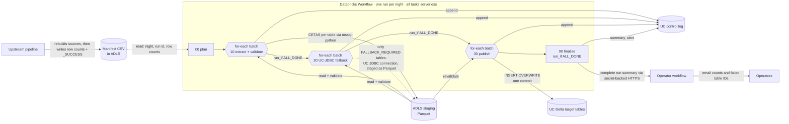

# Design: Synapse → Unity Catalog nightly full refresh

## 1. Problem and constraints

* About 1,000 tables and views in an Azure Synapse **dedicated SQL pool** are rebuilt
  nightly by an upstream process.
* Each night, every table must be copied **in full** into a Unity Catalog Delta table.
* Consumers must never see a half-loaded table. If a table fails, it keeps serving
  the previous night's data.
* Automatic publication targets **07:00 Australia/Sydney**. Targeted same-day
  recovery may publish until **11:00**, with a five-minute submission margin.
  An in-flight overwrite can still commit after a deadline and is reported by finalize.
* Tables are independent: each one switches to the new night on its own.

## 2. Architecture

The summary request includes every planned mapping's final outcome, even when
the job remains successful with optional failures. The external receiver
deduplicates the stable notification ID and delivers the actual email. An
early plan failure has no per-table outcomes and relies on the configured
Databricks job failure email. See [PACKAGE_GUIDE.md](PACKAGE_GUIDE.md) for the
file-level relationships and full one-time/daily/recovery sequence,
[CODE_STRUCTURE.md](CODE_STRUCTURE.md) for module dependencies and call
sequences, and [DATA_DICTIONARY.md](DATA_DICTIONARY.md) for the control-table
columns.

### Per-table flow (split across the extract, fallback and publish tasks)

Extract and publish call the same `process.process_table` steps; the fallback task
runs `bridge/fallback.py`. There is no in-task JDBC route: a table CETAS cannot serve
always goes to the fallback task.

1. **Target schema check**: the table must exist with exactly the inventory schema.
2. **Precheck** in the target's own Delta history. If this night, or a newer one, is
   already committed, verify the existing publication. Nothing is exported.
   Read-only recovery verification may finish after the cutoff.
3. **Cutoff check**: past the cutoff, a table without an existing commit is skipped.
4. **Source checks**, normally with **no per-table Synapse query**:
   * The schema hash was computed in the plan by one catalog query for all tables, and
     must equal the inventory hash.
   * The expected row count comes from the upstream manifest. Only a table missing from
     the manifest is counted with `COUNT_BIG(*)`. A table with zero rows is rejected
     unless `allow_empty` is set.
5. **Export** (`10_extract_validate_batch`): CETAS, submitted through `mssql-python`, to a
   fresh folder, `…/<date>/<release>/<table>/<attempt>/`. Types are cast inside the
   `SELECT`, so the Parquet types are fixed. The external-table definition is dropped
   straight away; only the files are needed.

   **If CETAS itself fails** (not bad data, not pool capacity), or the CETAS Parquet holds
   a pre-1900 timestamp, the table is logged `FALLBACK_REQUIRED` and the extract task
   moves on. The **`20_serverless_jdbc_fallback`** task (`bridge/fallback.py`) then
   re-exports it once through the Unity Catalog JDBC connection into a sibling
   `…-jdbc/` folder:
   * it uses the same casting `SELECT` (`contract.jdbc_select_sql`);
   * it runs as a parallel read when the mapping names a `jdbc_partition_column`;
   * every read is bounded by the publication deadline (`queryTimeout`);
   * the row count is proven (the manifest count, or one UC-JDBC `COUNT_BIG` when the
     manifest has none or disagrees).
6. **Validate**: one pass over the Parquet, before anything is written:
   * column names, order and types;
   * row count against the source;
   * per-column conversion loss, using `try_cast`, so a problem is counted rather than
     thrown under ANSI mode.

   A passing stage is logged `VALIDATED` (with its path and proven count). Extraction and
   fallback stop here.
7. **Overwrite** (`30_publish_batch`, no Synapse access): the stage is re-read and
   revalidated, then a single `INSERT OVERWRITE` into the existing table, guarded by
   Delta idempotent-write identifiers (see 3.2) and tagged with `userMetadata`.
8. **Verify** from Delta history: the commit for this release exists with the right row
   count. If the count is wrong, the table is restored automatically to the previous
   version (only when no newer commit exists).

## 3. Key decisions

### 3.1 Overwrite the table in place

The consumer object is the Delta table itself. `INSERT OVERWRITE` replaces all rows in
one atomic commit, and readers see either the old version or the new one.

Because the table is not dropped and recreated, grants, comments, properties
and history remain attached. This `INSERT OVERWRITE`/`RESTORE` path is not
qualified for targets with effective row filters or column masks; such targets
fail the preflight and require a separately reviewed publication design.

Rollback is Delta `RESTORE` for targets without row filters or masks.

*Rejected:* candidate table + snapshot table + view + pointer table (the v6 design).
That design wrote every row twice per night. It kept many full copies, and
needed its own pointer protocol, high-water marks, leases and recovery commands. It also
put policies on a view over a physical table, which complicates row filters and masks.

### 3.2 Delta's idempotent-write guard replaces leases and high-water marks

Each overwrite runs with two settings:

* `txnAppId = "bridge:<mapping_id>"`, constant per table;
* `txnVersion = upstream_sequence`, which strictly increases per night.

Delta skips any write whose version is not greater than the last one committed for
that app id. From that one mechanism:

| Situation | Result |
|---|---|
| Retry after a lost acknowledgement | Skipped: no duplicate, no double load |
| A stuck older job finishes after a newer night | Skipped: the older night can never overwrite the newer one |
| Two runs of the same night at once | Only one commits (Delta detects the conflict) |

A skipped write returns normally, so the outcome is always read back from history
(`verify_after_write`). **This behaviour is checked on your runtime by
`acceptance_checks.py` before go-live.**

### 3.3 Cast types in the export query

`smallint`/`tinyint` → `int`, `money` → `decimal(19,4)`, `real`/`float` → `double`,
datetimes → `datetime2(6)`, `uniqueidentifier`/`time` → text.

Casting in the CETAS `SELECT` makes the Parquet types predictable. It also removes the
need for Copy Activity, and lets the generator map almost every common column
automatically.

Export expressions are **derived at runtime** from the column metadata in the inventory.
They are never stored, so a hand-edited inventory cannot inject SQL.

**Datetimes** become `timestamp_ntz`, preserving the wall clock exactly. SQL Server
datetimes carry no time zone, and a plain `timestamp` would display shifted for a Sydney
user. `datetimeoffset` is normalised to UTC and becomes `timestamp`, a real instant.

### 3.4 One workflow per night

In 4A the job is `plan → for-each(extract) → for-each(UC-JDBC fallback) → for-each(publish)
→ finalize`, every task on serverless compute. This replaces thousands of separate job
runs, each paying its own start-up cost.

**Known limitation (open design decision).** Each for-each is a barrier: no table
publishes until every extract batch and every fallback batch has finished, so a slow
extraction tail delays every publication. Each fallback read is bounded by the
publication deadline so it cannot hold the whole night past the cutoff, and each table
is still skipped individually at the deadline. Publishing per batch would need a
reviewed job-graph change.

**Why CETAS can run from serverless.** CETAS always executes inside the Synapse
dedicated SQL pool; the Databricks task only submits the T-SQL command and waits for
it. Serverless (Spark Connect) has no JVM gateway, so the command connection uses
Microsoft's `mssql-python` DB-API driver, installed by the job environment. This
avoids relying on an undocumented attempt to run DDL through a read-only
remote-query pattern. Bulk fallback reads use the Unity Catalog JDBC connection instead.

Tables in a batch run sequentially, so the **for-each concurrency equals the maximum
number of concurrent CETAS statements** on the pool.

Batches are packed largest-first, so big tables start early instead of last.

### 3.5 Deterministic and transient failures are handled differently

| Kind | Examples | Handling |
|---|---|---|
| Deterministic | schema drift, contract or type drift, target schema mismatch, empty source | Logged. Skipped by automatic retries within this job run; a fresh run reassesses a repaired table. |
| Transient | export error, count mismatch, write not committed | The batch task fails at the end, and its single retry reprocesses **only** these tables, with a fresh export. |

### 3.6 Append-only control log

`table_log` and `run_log` are append-only; plan rows for a restarted plan task
can be replaced. Blind log appends allow concurrent batches. Each job reads only
its own `table_log` rows for retry and finalization. The `table_latest` view
shows the latest event across job runs for each release and table, and
`table_current` is an operational log view; inspect Delta history if a target
was changed outside this job.

### 3.7 Retention is configuration, not code

* **Staging Parquet**: an ADLS lifecycle rule (default 3 days).
* **Old Delta versions**: `delta.deletedFileRetentionDuration` (default 7 days) sets the
  rollback window. VACUUM runs through predictive optimization, or the weekly
  maintenance job.

### 3.8 Special characters and data errors

Text is exported as Parquet, so line breaks, pipes, quotes, tabs and Unicode cannot
split rows or columns. They round-trip exactly (tested).

The plan step checks that the reused Synapse file format is PARQUET and that the data
source points at `staging.root`. It fails the night early otherwise.

Two data problems still reach CETAS:

* **Maximum-value datetimes** would overflow when rounded to microseconds. They are
  truncated instead.
* **Genuine source-data errors** (overflow, failed conversion, divide by zero in a view)
  become the final status `FAILED_SOURCE_DATA` instead of being retried.

### 3.9 JDBC fallback (added in 1.3)

CETAS is the primary route because the dedicated pool writes Parquet from every
distribution in parallel. JDBC and Copy Activity both pull rows back through the pool's
control node, so neither is fast enough to be primary.

When CETAS itself fails, `synapse.classify_export_error` decides what happens:

| Class | Examples | Action |
|---|---|---|
| `DATA` | overflow, failed conversion, divide by zero (known error numbers, or SQLSTATE class 22 without a number) | `FAILED_SOURCE_DATA`; no retry, no fallback (the same `SELECT` fails either way) |
| `CAPACITY` | timeout, connection loss, throttling, tempdb/log full, no SQL error at all | `FAILED_EXPORT`; single task retry, no fallback (a second route competes for the same pool) |
| `CETAS` | anything else from CETAS: storage write failures, PolyBase/CETAS limits | `FALLBACK_REQUIRED`; the later serverless task re-exports that table once through the UC JDBC connection |

The fallback is JDBC, not Copy Activity. The owner's JDBC connection already works, so
nothing new is needed; Copy Activity would add a pipeline, management-API calls and its
own Parquet type encoding.

The fallback stages Parquet rather than loading its DataFrame straight into Delta. That
way the slow source is read once, and the same validation, count check and guarded
overwrite apply to it. It reads datetimes with `preferTimestampNTZ`, so wall-clock
values do not depend on the JVM time zone, uses `jdbc_fetch_size`, reads in parallel
when the mapping names a `jdbc_partition_column`, and bounds every read with a
`queryTimeout` that ends before the publication deadline. If the fallback also fails,
the table ends `FAILED_EXPORT` (or `FAILED_COUNT_MISMATCH`) with `method = JDBC`.

### 3.10 Freshness gate (added in 1.3)

An automatic run (no `business_date`) requires today's Sydney business date in the
upstream manifest and its `_SUCCESS` marker. The plan waits up to `upstream_wait_minutes`, bounded by the
fixed 07:00 morning deadline, and then fails loudly. The table flow checks the deadline
again before publication; finalization fails if any table's Delta commit landed after the deadline.

Without this gate, a late upstream would make the plan pick last night's run: every
table would report `ALREADY_CURRENT` and the job would look green while nothing
refreshed.

### 3.11 Upstream manifest and minimal Synapse reads (added in 1.4)

The upstream writes a CSV of row counts to ADLS:
`business_date, upstream_run_id, [upstream_sequence], schema, table, row_count`, with
configurable header names and delimiter. It writes a `_SUCCESS` marker after the CSV is
complete. The marker contains JSON identifying
the exact business date, run id, and sequence of the CSV. On a same-day correction,
the upstream removes its prior marker before touching source tables, publishes
the replacement CSV atomically, and writes the new marker last.
Before removing that marker or changing sources, the upstream must also wait
until the prior bridge generation has finalized and all exports have stopped.
The marker only gates new plans; it does not stop a CETAS or JDBC query already
running. Dedicated SQL pools default to READ UNCOMMITTED, and even enabling
RCSI would protect individual statements rather than make all exports share
one snapshot. The upstream scheduler must enforce this no-overlap contract.

The plan reads it once, using the exact file bytes, and every table's count comes from
it. This removes a full `COUNT_BIG` scan per table.

**Trust rules**
* The night and run id *inside* the file must match; file timestamps are never used.
  They are UTC (01:00 in Sydney is "yesterday" in UTC), and reruns rewrite files on the
  same day.
* A bad row only drops that table's count, and the table falls back to `COUNT_BIG`.
* A reported zero for a nonempty-required table is verified in Synapse before
  the table is rejected; a wrong zero must not block a valid export.
* A whole-file problem fails the plan when the manifest is the completion signal;
  otherwise all tables fall back to `COUNT_BIG`.
* The count still has to match the export. If it doesn't, one `COUNT_BIG` for that
  table decides between "the manifest was wrong" (publish, logged) and "the export is
  short" (refuse).

**Completion signal.** 4A requires `upstream.completion_source = "manifest"`
(`contract.variant_4a_problems` refuses anything else before deploy), so the
manifest plus its marker is the completion signal. The shared code still contains a
`synapse_table` mode (a COMPLETE row in a Synapse table); its setup script is not
shipped with 4A. An automatic run looks only for today's manifest and waits up to
`upstream_wait_minutes` or the morning deadline, whichever comes first. The
sequence comes from `upstream_sequence`, or `yyyymmdd * 100` if absent. A same-day
correction must use a higher revision (`…01`).

**Schemas.** One catalog query in the plan hashes every source schema. The per-table
Parquet contract check still catches any change made after the plan.

**Synapse access per night (manifest mode, no failures):**
* two tiny catalog lookups;
* one catalog query;
* one CETAS per table.

### 3.12 Deployment through GitHub Actions (added in 2.6.5)

The Asset Bundle is deployed by GitHub Actions, dev first and prod after a
human approval, using GitHub OIDC so no long-lived deployment secret exists.

* **One inventory path at runtime, one inventory per environment in Git.**
  The notebooks keep reading the fixed `config/inventory.json`, so a job
  parameter still cannot redirect privileged reads and writes. Each
  environment's reviewed inventory is committed as `config/inventory.<env>.json`;
  `tools/prepare_deploy.py` validates it with the job's own rules and copies it
  into place just before `bundle deploy`. A bad inventory fails the deploy,
  not the nightly run. Other environments' inventories are excluded from the
  deployed files.
* **Schedule state is configuration.** `pause_status` comes from bundle
  variables that default to `PAUSED`. Go-live is a reviewed change to the prod
  GitHub Environment variable, and later deploys keep the schedule as set. An
  unpause done only in the Databricks UI would be undone by the next deploy.
* **Deployment identity is separate from the job identity.** The deploying
  identity creates jobs and files; the jobs still run as `job_identity`
  (`run_as`). The deploying identity needs the Service Principal User role on
  it, and nothing in Synapse or on the target data.
* **Not automated on purpose.** Synapse SQL, Unity Catalog DDL (including any
  later reviewed `ALTER TABLE`), grants and secrets stay manual per environment
  (AGENTS.md section 8: no automated creation of tables, grants or credentials).
  Schema changes must be applied before merging code that depends on them.

Rejected alternative: choosing the inventory with a job parameter or a
per-target path in `databricks.yml`. That would let a job runner, or a wrong
target, point the job at another environment's catalogs.

## 4. Failure behaviour

| Failure | What consumers see | What to do |
|---|---|---|
| CETAS error or timeout | Yesterday's data for that table | Automatic retry once; then repair the run |
| CETAS data error (overflow, conversion, divide by zero) | Yesterday's data | `FAILED_SOURCE_DATA`: not retried; fix the source or view |
| CETAS-specific failure (storage write, CETAS limit) | New data via the UC-JDBC fallback task, if it succeeds | Check `FALLBACK_REQUIRED` rows (`error_code` not null); a table that falls back every night needs a CETAS fix |
| Upstream not finished for tonight (automatic run) | Yesterday's data everywhere | Plan waits `upstream_wait_minutes`, then fails and alerts |
| Manifest row wrong or missing for a table | New data (the table is counted in Synapse instead) | Warning in the `PLANNED` run-log row; fix the upstream CSV |
| Manifest count ≠ export, and Synapse confirms the export | New data | `count_source = synapse_after_manifest_mismatch`; fix the upstream count |
| Manifest count ≠ export, and Synapse agrees with the manifest | Yesterday's data | `FAILED_COUNT_MISMATCH`: the export was short; retried once |
| Manifest unreadable or for another night (manifest completion mode) | Yesterday's data everywhere | Plan fails loudly; fix the file or run with `business_date` |
| Reused file format is not Parquet, or data source points elsewhere | Yesterday's data everywhere | Plan fails before any table; fix the settings or the objects |
| Source schema changed | Yesterday's data | Review and regenerate the mapping, redeploy (see runbook) |
| Parquet/count/type mismatch | Yesterday's data | Investigate the source; repair the run |
| Serverless task or driver lost mid-write | Old or new version, never partial | Retry is safe; history decides the status |
| Committed row count wrong (should never happen) | Restored automatically to the previous version | Investigate; alert raised |
| Cutoff reached | Yesterday's data for tables not yet started | Tables already running finish |
| Job run twice for the same night | No change; statuses show `ALREADY_CURRENT` | Nothing |
| Rerun finds an earlier run's commit that no longer matches the evidence | That commit is kept (never auto-restored) | `FAILED_VERIFY`: inspect; roll back manually or republish with a higher sequence |

## 5. Capacity and cost

Per table, per night:

* one Synapse scan, for the CETAS itself. Row counts come from the upstream manifest;
  `COUNT_BIG` runs only for a table missing from it, or to settle a disagreement;
* one Parquet write;
* one Delta write.

In steady state, with the defaults, each table's storage holds:

* the current Delta version;
* about 7 older versions (the 7-day rollback window);
* successful staging is deleted after publication; failed and interrupted stages
  remain up to 3 days under the lifecycle policy.

Shorten the lifecycle rule and the retention duration to trade rollback depth for
storage.

**Tuning order**

1. Set `export_concurrency` to what the pool's workload group allows. Start with 6 at
   DW2000c and watch queueing in `sys.dm_pdw_exec_requests`.
2. Serverless sizes the Spark side automatically; watch task durations in the job run
   and the pool's queueing, not a cluster size.
3. Record `estimated_bytes` (`generate_inventory.py --profile`) so batching can put the
   largest tables first.
4. Measure a full night in a non-production environment. The cutoff protects
   consumers, but a table skipped at the cutoff is a day stale.

## 6. Security

* The nightly job runs as a service principal on serverless compute. Command SQL
  (plan checks, counts, CETAS) uses `mssql-python`; the fallback reads through the
  Unity Catalog JDBC connection, which needs `USE CONNECTION`.
* Synapse authentication reuses the existing JDBC identity, in one of three modes:
  * a Unity Catalog service credential (managed identity, no secret) — preferred;
  * a service principal secret, held in a secret scope;
  * a SQL login, held in a secret scope.
* The job needs WRITE FILES on the staging location, because the fallback writes Parquet
  there.
* Synapse grants: SELECT on the source schemas, plus the CETAS permissions on
  `bridge_meta` (`sql/synapse/01_export_setup.sql`).
  `ALTER ANY EXTERNAL DATA SOURCE` reaches all database-scoped credentials in
  the database. Review them with `sql/synapse/03_review_credential_scope.sql`
  before granting it, and isolate the export if unrelated credentials exist.
  The target writer must also be exclusive while automatic verification may
  invoke RESTORE: a separate writer can commit after the version check but
  before RESTORE, which has no compare-and-swap option. Both are deployment
  security and coordination requirements; local tests cannot enforce them.
* Deployment: GitHub Actions signs in with OIDC (no stored secret); prod deploys
  need approval on the `prod` GitHub Environment and only run from `main`. The
  deploying identity is not the job identity (see 3.12).
* Unity Catalog grants: MODIFY/SELECT only on the target tables and the control schema,
  READ FILES and WRITE FILES on the staging external location, and USE CONNECTION on
  the UC JDBC connection (`tools/render_uc_setup.py`).
* Consumer grants go directly on the target tables. Row filters and column masks
  on targets are outside this full-overwrite design: their
  write and RESTORE support requires a separately reviewed publication approach.

## 7. What is verified where

| Behaviour | How it was verified |
|---|---|
| Type mapping, inventory validation, SQL builders, injection refusal | Unit tests |
| Planning, cutoff across Sydney DST, precheck/verify/rollback decisions | Unit tests |
| Per-table flow: every failure path, lost acknowledgement, retry skipping | Unit tests with fake platform operations |
| Parquet validation, conversion, wall-clock preservation, ANSI-safe loss detection, `INSERT OVERWRITE` SQL, target schema check | Tests on a real local Spark session |
| JVM JDBC command connection (maintenance), real Java error-code extraction, the fallback's Parquet staging (plain and partitioned) | Real JDBC against Derby |
| `mssql-python` error classification (SQLSTATE and error number recovery) | Unit tests; real-driver tests when `mssql-python` is installed |
| Deferred UC-JDBC fallback and serverless publish flow | Notebooks executed against fakes (`test_v266_regressions.py`, `test_v267_regressions.py`) |
| Bundle structure and serverless compute placement | YAML-parsed locally (`test_tools.py`, `test_compute_variant.py`); run `databricks bundle validate -t dev` before deploying |
| **Delta skips lower/equal `txnVersion` on SQL `INSERT OVERWRITE`; history metadata; RESTORE; properties kept** | **`acceptance_checks.py`, run once on your workspace. Required before go-live.** |
| UC-JDBC read options, `mssql-python` login and CETAS command path | `acceptance_checks.py` on serverless |
| CETAS Parquet encoding of each cast type; Synapse permissions | First non-production night. Check `table_log` for `FAILED_CONTRACT`. |
| Grants surviving overwrite on real targets; governed targets rejected | First non-production night, checked manually |

## 8. Limits and non-goals

* **No cross-table atomic cutover.** Each table switches independently. If consumers
  need a consistent set, publish a group pointer or snapshot instead (a different design).
* **Write fence.** The upstream must not modify sources between its `_SUCCESS` marker and the job's
  FINISHED event. The export cannot detect a concurrent rewrite; the row count only
  catches some cases.
* **Unsupported types**: `(n)varchar(max)`, binary, `xml`, spatial and `sql_variant`
  need a reviewed view that casts or excludes them.
* **Full reload only.** For large tables that change little, an incremental load
  (MERGE or `replaceWhere`) would be cheaper; that is out of scope here.
* **Republishing a night after a manual rollback** needs a new manifest with a higher
  `upstream_sequence`, because the guard remembers the newer version.

## 9. Migrating from the legacy v6 system

"v6" here is the **earlier, separate snapshot-and-view system** this package
replaces. It is not a version of this package (this package is numbered 1.x–2.x;
see `CHANGELOG.md`). Skip this
section for a new installation with no v6 system in place.

v6 consumer objects are **views** with the same names the new design uses for
**tables**, so they cannot coexist.

1. Choose new target schemas, or drop each v6 view in a planned change window before
   running `uc_setup.sql`.
2. Run both systems in parallel against different schemas for a few nights, and compare
   counts and checksums.
3. Switch consumers over, then retire the v6 jobs, its control tables, and the `_snapshots`
   and candidate tables.
