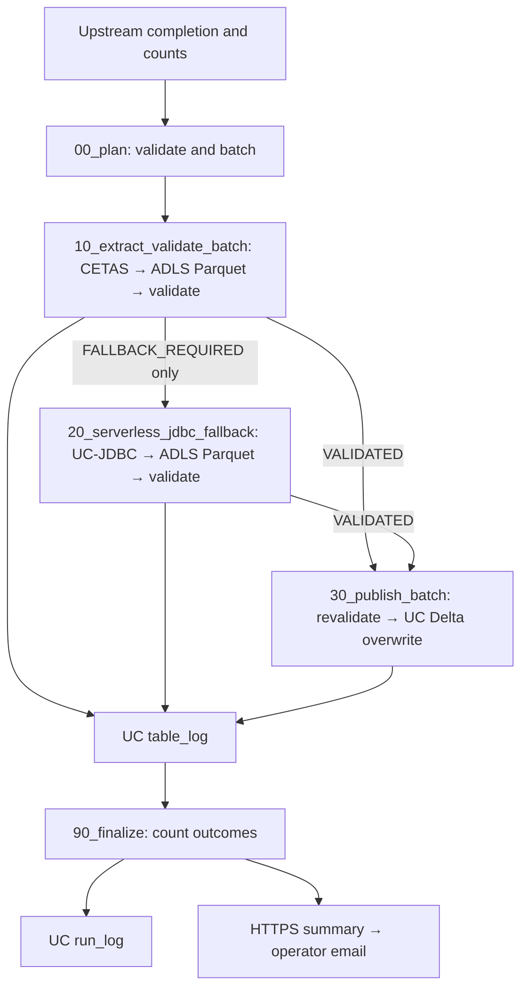
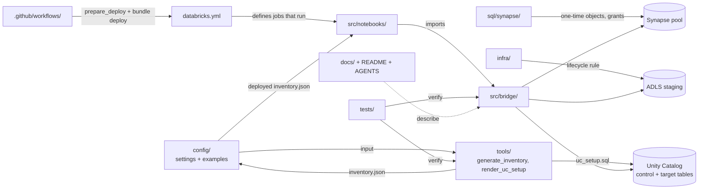

# Package guide — 4A — serverless CETAS + serverless JDBC fallback (v2.6.9)

**Nightly flow:** `Refresh complete → serverless plan/CETAS → serverless UC-JDBC fallback only when required → serverless Delta publish → final summary`

No dedicated cluster is defined in the nightly job. A UC JDBC connection is
required for fallback reads. See [DESIGN.md](DESIGN.md) section 3.4 for the
compute boundary.

This is the navigation guide for the shipped files. Read [DESIGN.md](DESIGN.md)
for the detailed safety decisions, [CODE_STRUCTURE.md](CODE_STRUCTURE.md) for
module dependencies and call sequences, [DATA_DICTIONARY.md](DATA_DICTIONARY.md)
for control-table columns and identifiers, and [RUNBOOK.md](RUNBOOK.md) for exact
setup, deployment, recovery, and rollback commands. File roles below describe the
package as delivered. 4A uses the upstream manifest CSV as its completion signal.

## 1. What the package does

Each Sydney business date, an upstream completion signal certifies that the
Synapse source set is ready. The Databricks job plans enabled mappings, exports
each source through CETAS (with a bounded JDBC fallback for eligible failures),
validates the staged Parquet, and atomically overwrites each Unity Catalog Delta
target. CETAS and validation, the Unity Catalog JDBC fallback, and publication run
as three separate serverless for-each tasks. A table failure is logged without stopping unrelated tables. After the
last batch, finalize records the run result and POSTs one complete summary to
an operator-owned HTTPS workflow. That workflow formats and delivers the email.

The nightly notebooks (plan, extract, fallback, publish, finalize) are ordered by `databricks.yml`. The Python modules in
`src/bridge` implement reusable logic; notebooks supply Spark, Synapse, storage,
secrets, and job parameters. The `sql`, `tools`, and `infra` folders prepare the
environment; they do not run once per table each night.

### How the folders relate

| Folder | Role | When it is used | Depends on / feeds |
|---|---|---|---|
| `config/` | The contract: which tables, where, and how | Setup; read by every job run | Filled by operator and `tools/`; read by notebooks and `tools/render_uc_setup.py` |
| `tools/` | Generators run from a workstation | Setup and when tables change | Reads `config/` and the Synapse catalog; writes `inventory.json` and UC setup SQL |
| `sql/synapse/` | Pool-side objects and permissions | One-time setup | Creates what `src/bridge/synapse.py` uses (schemas, scoped credential, external data source, Parquet file format, job user and grants) |
| `infra/` | Storage retention and identity notes | One-time setup | Cleans the ADLS staging folders written by the job |
| `.github/workflows/` | CI/CD | Every pull request and merge | Runs `tests/`, `tools/prepare_deploy.py` and `databricks bundle deploy` |
| `databricks.yml` | Job definitions | Deployment | Runs the notebooks with parameters, compute (serverless environment; job clusters only for maintenance and rollback), schedule, retries |
| `src/notebooks/` | Job entry points | Every run | Import `src/bridge`; hold Spark, `dbutils` and secret handles |
| `src/bridge/` | All logic and decisions | Every run | Used by notebooks, `tools/` and `tests/` |
| `tests/` | Local verification | Every change | Tests `src/bridge`, `tools/`, `databricks.yml` and `AGENTS.md` |
| `docs/` | Human documentation | Reading | Describes all of the above |

Module-level dependencies, the notebook-to-module map and call sequences are in
[CODE_STRUCTURE.md](CODE_STRUCTURE.md).

## 2. Folder and file inventory

Every file below lists **who** runs or reads it, **when**, and its place in the
**order**. Order references the steps in section 3: *Setup 1–6* (one-time, per
environment), *Night 1–5* (every automatic nightly run), and *Recovery*.

**Who**

| Role | Is |
|---|---|
| Synapse admin | Dedicated SQL pool administrator |
| Storage admin | Owner of the ADLS staging account |
| UC admin | Unity Catalog administrator (runs DDL and grants in a SQL warehouse) |
| Platform engineer | Person installing and changing the package (settings, inventory, deploy) |
| Upstream team | Owners of the pipeline that rebuilds the Synapse sources |
| CI/CD | GitHub Actions workflows |
| Nightly job | Databricks job `nightly_full_refresh`, running as the job service principal on serverless |
| Operator | Member of `operations_group`: monitors, reruns, repairs |
| Rollback approver | Member of `rollback_approvers_group`: runs rollback and acceptance |
| Developer | Maintainer changing code, reviewing pull requests |

### Root

| File | Purpose and main input → output | Who | When | Order |
|---|---|---|---|---|
| `README.md` | Entry point: compute split per stage, prerequisites, and where to start reading. | Everyone | First | Before Setup 1 |
| `AGENTS.md` | Design invariants, architecture ownership, constraints, status vocabulary and change guidance for maintainers. | Developer, AI agents | Before any code or config change | — |
| `CHANGELOG.md` | Versioned changes. | Developer, platform engineer | When taking a new package version | — |
| `databricks.yml` | Asset Bundle definition. Serverless environment (`mssql-python`, `azure-identity`), operator job clusters, schedule, parameters, ACLs, task graph and retries → nightly, acceptance, rollback, and maintenance jobs. | Platform engineer edits hosts once; CI/CD deploys it | Setup 6 and every deploy | Setup 6 |
| `requirements-dev.txt` | Local development and test dependencies; the job runtime dependencies are declared in the serverless environment in `databricks.yml`. | Developer, platform engineer | Before running tests or `tools/` locally | Before Setup 4 |
| `.github/workflows/ci-cd.yml` | GitHub Actions: tests on pull requests; on merge to `main`, deploy to dev, then prod after approval; manual per-environment deploy. | CI/CD (triggered by developers' pull requests and merges) | Every pull request and merge to `main` | Setup 6 |
| `.github/workflows/bundle-deploy.yml` | Reusable deploy of one environment: checks variables, selects inventory, GitHub OIDC → Azure login, `bundle validate` and `bundle deploy`. | CI/CD (called by `ci-cd.yml`) | Each dev/prod deploy | Setup 6 |
| `.gitignore` | Excludes build output, Databricks state, Spark local files and Python caches from Git. Review sensitive generated inventory/settings before committing; this file does not exclude them. | Git | Every commit | — |

### `config/`: contract and example data

| File | Purpose and main input → output | Who | When | Order |
|---|---|---|---|---|
| `settings.example.json` | Copy to `settings.json`; supply Synapse, manifest, staging, control, execution, governance and summary-webhook secret settings → input to inventory generation. Every setting is explained in its `_comments` block (ignored by the job). | Platform engineer | Once per environment; again when settings change | Setup 3 |
| `inventory.example.json` | Two-table example of the complete validated inventory, including mapping schemas and notification settings → reference for the deployed `inventory.json`. | Platform engineer | When reviewing a generated inventory | Setup 4 |
| `row_counts.example.csv` | Example upstream row-count manifest fields → reference for the upstream pipeline's daily CSV. | Upstream team | When building the manifest output | Setup 2 |
| `success_marker.example.json` | Example `_SUCCESS` marker that certifies `row_counts.example.csv` → reference for the upstream pipeline's marker. | Upstream team | When building the manifest output | Setup 2 |

`config/settings.json` and `config/inventory.json` are **generated or filled in
locally** and are not shipped in the archive. With GitHub deployment, each
environment's reviewed inventory is committed as `config/inventory.dev.json` or
`config/inventory.prod.json`; `tools/prepare_deploy.py` copies the right one to
`config/inventory.json` during the deploy. The notebooks load the deployed
`inventory.json` (read by the nightly job and every operator job on each run);
they do not read `settings.example.json` at runtime. The upstream produces its
own real manifest CSV and `_SUCCESS` marker every night.

### `sql/synapse/`: pool setup and security review

Run by hand; never run by the job or CI/CD.

| File | Purpose and main input → output | Who | When | Order |
|---|---|---|---|---|
| `03_review_credential_scope.sql` | Read-only listing of credential, external data source and grant reach → administrator's permission review; run before granting export rights. | Synapse admin; security approver signs off | Once per pool, before any CETAS grant; again when credentials are added | Setup 1, first |
| `01_export_setup.sql` | Reviewed one-time Synapse schemas, external staging setup and CETAS grants → pool objects only where missing. Replace placeholders first. | Synapse admin | Once per pool, after the review is approved; only the parts that are missing | Setup 1, second |

### `infra/`: storage and access

| File | Purpose and main input → output | Who | When | Order |
|---|---|---|---|---|
| `infra/README.md` | Storage retention, identity/access check list and compute notes. | Storage admin, platform engineer | Before setup; when access is reviewed | Setup 1–2 |
| `infra/adls_lifecycle_policy.json` | Template for aging out staged ADLS files → storage account lifecycle rule after placeholders are set. | Storage admin (`az storage account management-policy create`) | Once per storage account | Setup 2 |

### `tools/`: workstation and deploy helpers

| File | Purpose and main input → output | Who | When | Order |
|---|---|---|---|---|
| `tools/generate_inventory.py` | `settings.json` + Synapse catalog (optional size profile) → reviewed `config/inventory.json`; rejects unsupported columns. | Platform engineer, from a workstation with Synapse ODBC access | Setup; again when a table is added or a source schema changes | Setup 4 |
| `tools/render_uc_setup.py` | Validated inventory + job principal and optional consumer group → `build/uc_setup.sql` for UC control and target tables/grants. | Platform engineer renders; UC admin reviews and runs the SQL | Setup; again when tables are added | Setup 5 |
| `tools/prepare_deploy.py` | Environment name → checks the bundle target host, validates `config/inventory.<env>.json`, copies it to `config/inventory.json`. | CI/CD (`bundle-deploy.yml`); platform engineer for a manual deploy | Every deploy, just before `bundle deploy` | Setup 6 |

### `src/notebooks/`: Databricks job entry points

| File | Purpose and main input → output | Who | When | Order |
|---|---|---|---|---|
| `acceptance_checks.py` | One-time workspace/runtime acceptance tests on serverless: Spark confs, Delta transactions, history, grants, restore, governance, UC-JDBC read options and the `mssql-python` CETAS path → go-live evidence, not production table data. | Rollback approver runs the `acceptance` job | After each environment's first deploy, before go-live; after runtime changes | Setup 6 |
| `_bootstrap.py` | Shared `%run` imports, UTC Spark settings, widget helper and fixed inventory path → initialized modules/settings. | Every notebook below | Start of every task | — |
| `00_plan.py` | Checks Synapse staging, finds today's completed upstream, reads counts and schemas, packs batches → UC `plan`, run log and task value `batch_ids`. | Nightly job (task `plan`) | 01:30 Sydney daily; manual targeted rerun | Night 1 |
| `10_extract_validate_batch.py` | Serverless CETAS + validation for one batch (`validate_only`) → CETAS stages and `VALIDATED`, or `FALLBACK_REQUIRED`; raises only for transient failures eligible for the one task retry. | Nightly job (for-each `process`) | After plan | Night 2 |
| `20_serverless_jdbc_fallback.py` | Wires `bridge/fallback.py` for one batch: UC-JDBC read of `FALLBACK_REQUIRED` tables bounded by the publication deadline → `-jdbc` stage and `VALIDATED`; raises for transient failures. | Nightly job (for-each `serverless_jdbc_fallback`) | After all extract batches; does nothing for a batch with no fallback tables | Night 3 |
| `30_publish_batch.py` | Publishes the batch's `VALIDATED` stages without Synapse access → revalidation, `INSERT OVERWRITE`, Delta-history verification, stage cleanup. | Nightly job (for-each `publish`) | After all fallback batches | Night 4 |
| `90_finalize.py` | Runs after the publish tasks (`ALL_DONE`); tallies statuses/deadline/fallbacks, writes `FINISHED*`, sends the complete webhook summary and applies the job's failure policy → run log, notification and final verdict. Operators read the summary email. | Nightly job (task `finalize`) | Last task of every run | Night 5 |
| `rollback.py` | Restricted operator tool: one target and a reviewed earlier version/date → guarded Delta restore. | Rollback approver runs the `rollback` job (`dry_run=true` first) | Only when a published table must be reverted | Recovery |
| `maintenance.py` | Weekly control retention, optional VACUUM and orphan CETAS definition cleanup → smaller logs and tidy Synapse metadata. ADLS files follow the lifecycle policy. | `maintenance` job (job cluster) | 14:00 Sydney every Sunday, once unpaused | Weekly |

### `src/bridge/`: implementation used by notebooks

Nobody runs these directly. They are imported by the notebooks (at the
notebook's time and order above), by `tools/` and by `tests/`. See
[CODE_STRUCTURE.md](CODE_STRUCTURE.md) section 4 for the exact notebook-to-module map.

| File | Purpose and main input → output | Used by |
|---|---|---|
| `__init__.py` | Marks the Python package; holds `__version__`. | All imports |
| `contract.py` | Validates inventory and identifiers; maps Synapse column types; builds safe export SQL and target names. Inventory/mapping → validated contract and SQL. | Every notebook; all three tools |
| `manifest.py` | Validates manifest settings and the completion marker; parses and checks upstream CSV rows. Storage contents → business date, sequence and expected counts. | `00_plan`, `acceptance_checks` |
| `synapse.py` | Obtains credentials, connects to Synapse (`mssql-python` on serverless), checks staging objects, reads source metadata/counts, issues CETAS, and classifies SQL errors. Mapping/settings → source information and exported files. | `00_plan`, `10_extract`, `20_fallback`, `maintenance` |
| `planning.py` | Business-date cutoff, batch packing, status sets, Delta-history decisions, retry classification and run totals. Plan/history → batch IDs or outcome decisions. | `00_plan`, `30_publish`, `90_finalize`, `rollback` |
| `process.py` | Per-table state machine and batch loop (`validate_only` for the extract phase, staged reuse for publish). Calls the injected platform operations, logs statuses and keeps tables independent. Plan/mapping → table outcomes. | `10_extract`, `20_fallback`, `30_publish` |
| `fallback.py` | Deferred UC-JDBC fallback for `FALLBACK_REQUIRED` tables: stage, validate, prove the count, log `VALIDATED` or the real failure status. Plan row/mapping → fallback outcome. | `20_fallback` |
| `loader.py` | UC-JDBC fallback staging, Parquet reading and validation, target overwrite, history inspection and restore. Stage/source → verified UC Delta publication. | All nightly notebooks, `rollback`, `acceptance_checks` |
| `control.py` | Append-only UC table and run logs, plan reads/writes, latest outcomes and summary queries. Events → `table_log`, `run_log`, `plan`. | All nightly notebooks, `rollback` |
| `notification.py` | Creates the complete summary payload; reads an HTTPS URL from Databricks secrets; POSTs JSON with a stable notification ID. Final outcomes → operator workflow request. | `90_finalize` |

### `docs/`: who reads which document

| File | Purpose | Who | When |
|---|---|---|---|
| `docs/PACKAGE_GUIDE.md` | This inventory and execution map. | Everyone | First, after `README.md` |
| `docs/DESIGN.md` | Architecture, table flow, safety and retry decisions. | Architect, developer, go-live approver | Before setup; before design changes |
| `docs/FIRST_RUN.md` | Complete step-by-step installation and first run: names to collect, Synapse and storage, secrets, settings, inventory, Unity Catalog, deploy, acceptance test, first load, prod go-live, and what to do when a step fails. | Platform engineer | To install; first |
| `docs/SETUP_CHECKLIST.md` | Tick-list version of the same path, with a map of every script (who runs it, where, how often) and the daily routine. | Platform engineer | Alongside `FIRST_RUN.md` |
| `docs/RUNBOOK.md` | Exact setup, deployment, daily monitoring, recovery and rollback instructions. | Platform engineer, operator | Setup 1–6; every morning; incidents |
| `docs/RELEASE_VALIDATION.md` | Go-live acceptance checklist and environment-specific checks. | Platform engineer, go-live approver | After deploy to dev and prod, before unpausing |
| `docs/UPSTREAM_MANIFEST_SPEC.md` | File contract for the nightly row-count CSV and `_SUCCESS` marker: location, columns, business date, timing, corrections. | Upstream team (send with the two `config/` examples) | Before building the upstream output (Setup 2); when it changes |
| `docs/DATA_DICTIONARY.md` | Columns of `plan`, `table_log`, `run_log` and views; `run_log` events; ID and path formats; target metadata columns and Delta `userMetadata`; summary webhook payload. | Operator, developer, notification-workflow builder | When querying the logs or building the summary receiver |
| `docs/CODE_STRUCTURE.md` | Layers, jobs and tasks, module dependency graph, notebook-to-module map, call sequences, test coverage map. | Developer | Before changing code |

### `tests/`: local and CI verification

Run by developers locally (`python -m pytest tests -q`) and by CI/CD on every
pull request. Never deployed: `databricks.yml` excludes `tests/**`. Spark and
Derby tests need PySpark and Java; real-driver tests need `mssql-python`
(`requirements-dev.txt`); without them those tests are skipped.

| File | What it verifies |
|---|---|
| `tests/conftest.py` | Shared fixtures and Python import paths. |
| `tests/test_contract.py` | Inventory, type conversion and SQL safety tests. |
| `tests/test_manifest.py` | Manifest parsing and trust rules. |
| `tests/test_synapse_checks.py` | Synapse staging verification and error classification. |
| `tests/test_planning.py` | Batching, cutoff, history and summary rules. |
| `tests/test_process.py` | Per-table and batch paths with simulated platform operations. |
| `tests/test_loader_spark.py` | Real local Spark Parquet and conversion tests; optional Spark dependency. |
| `tests/test_jdbc_derby.py` | Local Derby JDBC round trips without a live Synapse pool. |
| `tests/test_notification.py` | Complete-summary payload, optional failure delivery and safe error reporting. |
| `tests/test_tools.py` | Inventory/setup generators and bundle structure. |
| `tests/test_compute_variant.py` | Every nightly and acceptance task is serverless; only maintenance and rollback use job clusters. |
| `tests/test_serverless_synapse_dbapi.py` | `mssql-python` adapter: error-number and SQLSTATE recovery, connection handling. |
| `tests/test_deploy.py` | Inventory selection, pause-status variables, sync excludes and workflow structure. |
| `tests/test_agents_doc.py` | Checks that architecture claims in `AGENTS.md` remain grounded in files/code. |
| `tests/test_v20_regressions.py` | Publication safety regressions found in v1.9 review. |
| `tests/test_v23_regressions.py` | Operational regressions found in v2.2 review. |
| `tests/test_v24_regressions.py` | Recovery, missing stage and JDBC route regressions. |
| `tests/test_v25_regressions.py` | Cross-run restore, manifest, cutoff and Spark-free regressions. |
| `tests/test_v251_regressions.py` | Live-clock cutoff regression. |
| `tests/test_v26_recovery.py` | Sydney recovery and publication-margin behaviour. |
| `tests/test_v262_regressions.py` | Runtime 18 review regressions. |
| `tests/test_v263_regressions.py` | Repair-run ownership, UC grants, governance exemptions and finalize retry. |
| `tests/test_v266_regressions.py` | Serverless publish/fallback notebooks executed against fakes; real `mssql-python` error classification. |
| `tests/test_v267_regressions.py` | Independent-review fixes: strict YAML, CETAS-error counting, SQLSTATE class 22, deadline-bounded and partitioned UC-JDBC fallback, final fallback statuses, 4A deploy checks, stage cleanup. |
| `tests/test_v268_regressions.py` | Deploy workflow pins `setup-cli` to a commit and matches CI's Python; RUNBOOK references to `RELEASE_VALIDATION.md` resolve; no stale variant wording. |

## 3. Execution order and what moves between stages

### One-time setup, per environment (Setup 1–6)

1. Review the Synapse credential scope with `03_review_credential_scope.sql`.
   Confirm existing access; run `01_export_setup.sql` only for missing objects.
2. Apply the reviewed ADLS lifecycle policy and provide the upstream completion
   contract: the manifest CSV plus its `_SUCCESS` marker.
3. Fill `config/settings.json` from its example. Store the notification workflow
   URL in a Databricks secret and configure its scope/key in settings.
4. Run `tools/generate_inventory.py` to produce `config/inventory.json`. Review
   enabled/mandatory flags, column types, schemas and source mappings.
5. Run `tools/render_uc_setup.py` with the reviewed inventory; execute its SQL
   as an authorized UC administrator.
6. Deploy the Asset Bundle (for a new installation, follow RUNBOOK "Fresh
   installation with GitHub (dev, then prod)"), by hand or through GitHub Actions (merge to `main`
   → dev, approval → prod). Run the acceptance job and a trial load on the
   serverless job compute. Validate the notification receiver and its email.
   Then unpause the nightly schedule through the pause-status bundle variables. Commands and approvals are in RUNBOOK.

### Every automatic nightly run (Night 1–5)

| Order | Component | Consumes | Produces |
|---|---|---|---|
| Before | Upstream team's pipeline | Completed nightly Synapse rebuild | Matching business date/sequence; completion marker or row, optionally per-table counts. |
| Night 1 | `00_plan.py` (01:30 Sydney) | Inventory, completion signal, Synapse staging/catalog | UC plan, source schema hashes, batch IDs, 07:00 Sydney cutoff. |
| Night 2 | `10_extract_validate_batch.py`, per batch | Planned mappings, target history, Synapse, staging | CETAS stages and `VALIDATED`, or `FALLBACK_REQUIRED`. |
| Night 3 | `20_serverless_jdbc_fallback.py`, per batch | `FALLBACK_REQUIRED` mappings | UC-JDBC `-jdbc` stages and `VALIDATED`, or a failure status with `method = JDBC`. |
| Night 4 | `30_publish_batch.py`, per batch | `VALIDATED` stages | Delta commits (`INSERT OVERWRITE`), verified from history; append-only status events. |
| Night 5 | `90_finalize.py` | Every planned mapping and its latest run outcome | UC `FINISHED`/`FINISHED_WITH_FAILURES`, structured HTTPS summary, final job verdict. |

Each batch task of Nights 2–4 retries once after a transient failure, and the
retry repeats only the affected mappings; terminal and success statuses stay recorded.

The summary includes `NOT_STARTED` or cutoff-skipped mappings as failures.
Successful target writes survive unrelated table failures. The Databricks
on-failure email is an additional system alert when the job fails; the summary
endpoint is responsible for the table counts and IDs on *every completed run*.
If planning fails before a plan exists, there can be no table summary and the
system failure alert is used. Endpoint deduplication by `notification_id` is
necessary for delivery ambiguity or a manual Repair run.

### Morning investigation and same-day recovery (Recovery)

1. Read the summary email and inspect `table_log` for each failed mapping's
   `detail` and the earlier CETAS/JDBC events.
2. Correct the cause. A Databricks Repair run of the existing job retains its
   original 07:00 cutoff. From 07:00 to before 11:00 Sydney time, start a new
   targeted run using today's `business_date` and `only_mappings=<ids>`.
3. The targeted run rechecks each target's history and source release. A target
   already published for that release is verified and normally avoids a second
   export. Corrected upstream data requires a new, higher sequence.
4. The targeted run sends its own summary after its selected mappings finish.
   No new recovery run begins at or after 11:00; with the default five-minute
   safety margin, a new export must begin before approximately 10:55.

## 4. Boundaries and references

Local tests check code paths but cannot prove actual CETAS encodings,
serverless network and runtime behaviour, UC-JDBC connection options, UC permissions, HTTPS delivery or the production deadline.
Use [RELEASE_VALIDATION.md](RELEASE_VALIDATION.md) and the acceptance job for
those checks. For exact status meanings and operator commands, use
[RUNBOOK.md](RUNBOOK.md). For the governing invariants, use [AGENTS.md](../AGENTS.md).

### Suggested reading order

Overall order, from first contact to daily operation:

| # | Document | Why at this point |
|---|---|---|
| 1 | `README.md` | What the package does, compute per stage, prerequisites. |
| 2 | `docs/PACKAGE_GUIDE.md` (this guide) | Every folder and file: purpose, who, when, order. |
| 3 | `docs/DESIGN.md` | How it works and why; sections 1–4 are essential, 5–9 are reference. |
| 4 | `AGENTS.md` | The rules that must not be broken; required before changing anything. |
| 5 | `docs/UPSTREAM_MANIFEST_SPEC.md` | Send to the upstream team early: they have the longest lead time. |
| 6 | `docs/FIRST_RUN.md` | Do the installation and first run, every step in order. `docs/SETUP_CHECKLIST.md` is the shorter tick-list. |
| 7 | `infra/README.md` | Storage lifecycle and identity/access to check before setup. |
| 8 | `docs/RUNBOOK.md` | Reference for deployment (including GitHub Actions), daily checks, recovery and rollback. |
| 9 | `docs/RELEASE_VALIDATION.md` | Prove dev, then prod, before unpausing the schedule. |
| 10 | `docs/DATA_DICTIONARY.md` | Control-table columns for the daily checks and investigations. |
| 11 | `docs/CODE_STRUCTURE.md` | Only when changing code. |
| 12 | `CHANGELOG.md` | Only when taking a new package version. |

By role:

| Reader | Read |
|---|---|
| New to the package | `README.md` → this guide → `DESIGN.md` sections 1–2 |
| Platform engineer (installing) | `README.md` → this guide → `DESIGN.md` → `AGENTS.md` sections 2–3 → `FIRST_RUN.md` (or `SETUP_CHECKLIST.md`) → `infra/README.md` → `RUNBOOK.md` → `RELEASE_VALIDATION.md` |
| Upstream team | `docs/UPSTREAM_MANIFEST_SPEC.md` with `config/row_counts.example.csv` and `config/success_marker.example.json` |
| Synapse / storage / UC admin | `infra/README.md` → `RUNBOOK.md` "One-time setup" steps 1, 2 and 5 → `AGENTS.md` section 2 |
| Operator | This guide section 3 → `RUNBOOK.md` → `DATA_DICTIONARY.md` |
| Developer / maintainer | `DESIGN.md` → `CODE_STRUCTURE.md` → `AGENTS.md` → `DATA_DICTIONARY.md` |
| Go-live approver | `DESIGN.md` sections 6–8 → `RELEASE_VALIDATION.md` |
